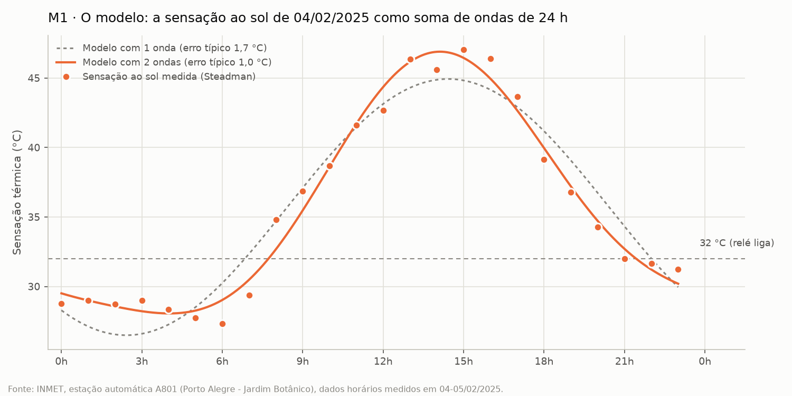
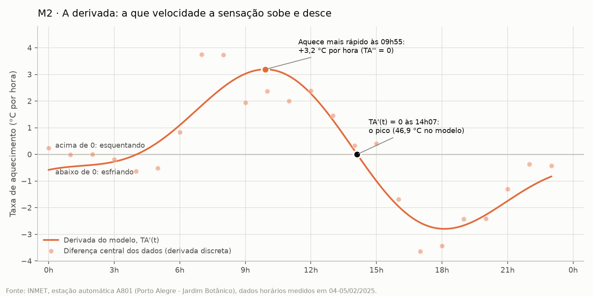
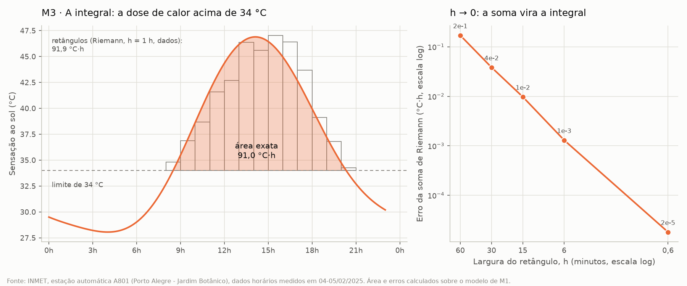
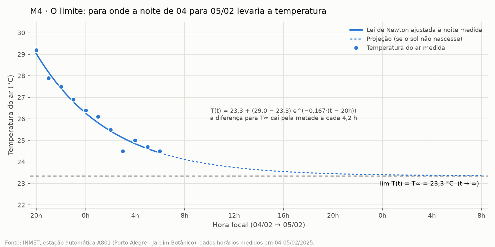

# Matemática — O calor de um dia visto pelo Cálculo

> Ficha da CitizenTech: ver o [README principal](../README.md).

**Disciplina:** Differentiated Problem Solving

## O problema
O jornal dá um número só: "máxima de 37 °C". Para quem vai passar a tarde no Parque Harmonia ou no Largo Glênio Peres, isso não basta. Queremos saber:
- **a que velocidade** o calor sobe de manhã e **a que horas** ele chega ao pico (derivada);
- **quanto calor** a pessoa acumula ao longo do dia acima do limite de risco (integral);
- **até onde** a noite consegue esfriar a cidade (limite).

## Os dados (reais, sem hipóteses)
- **Estação automática A801 do INMET** (Porto Alegre, Jardim Botânico), hora a hora, em **04/02/2025**: o dia em que o InGá mediu 61 °C no piso do Parque Harmonia ([Sul21, 05/02/2025](https://sul21.com.br/noticias/geral/2025/02/piso-de-concreto-do-parque-harmonia-chega-a-61-oc-formando-ilha-de-calor-no-centro-de-porto-alegre/)).
- A **sensação térmica ao sol** é a mesma fórmula da estação Forno Alegre (Temperatura Aparente de Steadman, com o sol medido pelo INMET). O código é o do [`python/`](../python/): `fontes/oficial.py` e `processamento/sensacao.py`.
- **34 °C** é o limite em que o relé da estação liga o nebulizador (nível laranja). É onde começa o laranja nas 5 faixas da [Nota Técnica nº 01/26 da Secretaria Municipal de Saúde de Porto Alegre](https://prefeitura.poa.br/sites/default/files/usu_doc/hotsites/sms/vigilancia-em-saude/NT%201_26_Calor%20extremo.pdf) (27/34/40/52 °C), a mesma régua da estação e do Python. Até 15/11/2026, usávamos 32 °C (da NOAA), e a dose dava 116,4 °C·h.

## O modelo e as análises

| Parte | Pergunta | Ferramenta do Cálculo | Resultado em 04/02/2025 |
|---|---|---|---|
| **M1 Modelo** | Que curva descreve o dia? | Soma de 2 ondas de 24 h, ajustada por mínimos quadrados | Erro típico de **1,0 °C** (R² = 0,979) |
| **M2 Derivada** | A que velocidade a sensação sobe? Quando para? | TA'(t), e TA'(t) = 0 no pico | Sobe até **3,2 °C/h** (às 09h55); para de subir às **14h07**, com **46,9 °C** |
| **M3 Integral** | Quanto calor se acumula acima de 34 °C? | ∫ (TA − 34) dt, comparada com as somas de Riemann | **91,0 °C·h** em **11,8 h** (das 08h30 às 20h20) |
| **M4 Limite** | Até onde a noite esfria o ar? | Lei de Newton, lim T(t) com t → ∞ | **23,3 °C**: a diferença cai pela metade a cada **4,2 h** |

### M1 — O modelo
```
TA(t) = a + b1·sen(ωt) + c1·cos(ωt) + b2·sen(2ωt) + c2·cos(2ωt),   ω = 2π/24 (t em horas)
```
- **Analogia:** o dia é como um balanço que vai e volta a cada 24 h. A 1ª onda é o balanço; a 2ª onda, com metade do período, deixa a subida mais rápida que a descida, como acontece no dia real.
- Com o período fixo, os coeficientes entram de forma linear, então o ajuste é um problema de **mínimos quadrados** que o NumPy resolve numa linha (`np.linalg.lstsq`).
- **Por que 2 ondas:** cada onda a mais diminui o erro, mas o ganho cai rápido (o erro típico é de 1,74 °C com 1 onda, 0,98 °C com 2, 0,84 °C com 3 e 0,65 °C com 4). Com 4 ondas, a curva começa a "ondular" para seguir cada ponto (sobreajuste). Ficamos com o modelo mais simples que segue a forma do dia.



### M2 — A derivada (o velocímetro do calor)
- **Analogia:** a derivada não diz quão quente está, e sim **com que rapidez** está esquentando, como o velocímetro do carro, que mostra a velocidade e não a distância.
- Como o modelo é feito de senos e cossenos, a derivada sai **exata**: (sen)' = cos e (cos)' = −sen, multiplicados por kω (regra da cadeia).
- **O aquecimento mais rápido** acontece onde a 2ª derivada é zero: **09h55, +3,2 °C por hora**.
- **O pico** acontece onde a derivada é zero: **14h07, 46,9 °C** no modelo. O pico medido foi de 47,0 °C, às 15h.
- **O que o modelo não pega:** nos dados, a maior subida foi de **+5,4 °C entre 7h e 8h**, quando o sol "liga" na fórmula. A curva suave espalha esse salto ao longo da manhã. Por isso, às 9h, o modelo diz 3,0 °C/h, e a diferença central dos dados (a derivada discreta) diz 1,9 °C/h.



### M3 — A integral (a dose de calor)
- **Analogia:** a conta de luz não cobra o pico de consumo, cobra os kWh somados no mês. Com o calor é igual: a **dose** é a área da curva acima de 34 °C, em **°C·h** (graus-hora).
- **A área exata** sai pelo **Teorema Fundamental do Cálculo:** acha onde a curva cruza os 34 °C (por bisseção) e calcula F(fim) − F(início) com a primitiva do modelo. O resultado é **91,0 °C·h**. Em média, foram **7,7 °C acima do limite durante 11,8 horas**.
- **A soma de Riemann** com os dados, de hora em hora, dá **91,9 °C·h** (13 horas medidas acima do limite). É o que se calcula com uma planilha, somando uma hora de cada vez. As regras da esquerda, da direita e do trapézio dão o mesmo número aqui, porque a dose vale 0 nas duas pontas do dia.
- **h → 0:** com retângulos cada vez mais finos sobre o modelo, a soma se aproxima da área exata. O erro é de 0,17 °C·h com h = 60 min e de cerca de 0,00002 °C·h com h = 36 s. Quando h cai pela metade, o erro cai cerca de 4 vezes. Essa é a **definição da integral**: o limite da soma de Riemann.



### M4 — O limite (a noite que não refresca)
```
T(t) = T∞ + (T0 − T∞)·e^(−k·(t − 20h))      T∞ = 23,35 °C,  T0 = 29,04 °C,  k = 0,167 por hora
```
- **Analogia:** um café esfria rápido no começo e devagar depois, e nunca fica mais frio que a sala. É a **lei do resfriamento de Newton**.
- O ajuste usa a temperatura do **ar** das 20h (sem sol) até as 6h do dia 05 (antes do sol nascer), com erro típico de 0,24 °C. Para um T∞ fixo, ln(T − T∞) é uma reta: o código testa os valores de T∞ de 0,01 em 0,01 °C e fica com o de menor erro.
- **lim T(t), com t → ∞, = T∞ = 23,3 °C**, porque e^(−kt) → 0. Mesmo que a noite não acabasse, o ar ficaria perto de 23 °C. A mínima medida foi de 24,5 °C.
- **Interpretação:** uma noite que não desce de 20 °C é chamada de **noite tropical**. O corpo não recupera do calor do dia, e o dia seguinte começa já quente (em 05/02, a máxima chegou a 35,0 °C de novo).



## Limitações (o que o modelo não diz)
- Os dados são da **estação oficial**, num gramado aberto. Por isso eles mostram o tempo da cidade, e não o calor do piso do Largo. No concreto, a dose seria maior. Para medir isso, servem as estações Forno Alegre no próprio local.
- O modelo de 2 ondas é **suave**: ele atrasa o salto da manhã e adianta o pico em cerca de 1 hora (14h07 no modelo × 15h na medida).
- O dia não é exatamente periódico (o 05/02 começou mais quente que o 04/02), e o modelo de 24 h supõe que é.
- A lei de Newton supõe uma "sala" de temperatura fixa. Na cidade, essa "sala" muda (vento, nuvens, o calor que o concreto devolve). Às 3h, a medida caiu para 24,5 °C e depois subiu para 25,0 °C, e o modelo não acompanha esse vaivém.

## Quickstart
Usa o mesmo ambiente do [`python/`](../python/README.md) (ver o Quickstart de lá para criar o `.venv`).
```powershell
cd matematica
..\python\.venv\Scripts\python.exe analise.py              # resumo no terminal, resultados.json e os 4 gráficos
..\python\.venv\Scripts\python.exe -m pytest                  # 9 testes do Cálculo (em testes/)
```

## Arquivos
```
matematica/
├── calculo.py · analise.py · graficos.py   o código
├── testes/                                 os testes do Cálculo
├── graficos/                               os 4 PNGs
├── relatorio/                              o PDF entregue no Teams
└── resultados.json                         todos os números
```

| Arquivo | O que faz |
|---|---|
| `calculo.py` | Matemática pura com NumPy: ajuste, derivadas, primitiva, bisseção, Riemann e a lei de Newton |
| `analise.py` | Lê o INMET (pelo `python/fontes/oficial.py`), roda M1–M4, imprime o resumo e grava o `resultados.json` |
| `graficos.py` | Os 4 gráficos em `graficos/` (mesma paleta, segura para daltonismo, do Python) |
| `testes/test_calculo.py` | 9 testes com funções de resposta conhecida (ex.: ∫ de meia onda = 96/π) |
| `resultados.json` | Todos os números, para o relatório |
| `relatorio/relatorio_matematica.pdf` | O relatório técnico entregue no Teams |

## Relatório técnico (PDF)
[`relatorio/relatorio_matematica.pdf`](relatorio/relatorio_matematica.pdf) (10 páginas): problema, dados, modelo, derivada, integral, limite, interpretação, limitações, conclusão e referências, com os 4 gráficos. Ele foi escrito num documento editável do Claude e exportado em PDF. Se o texto mudar, exporte de novo.
