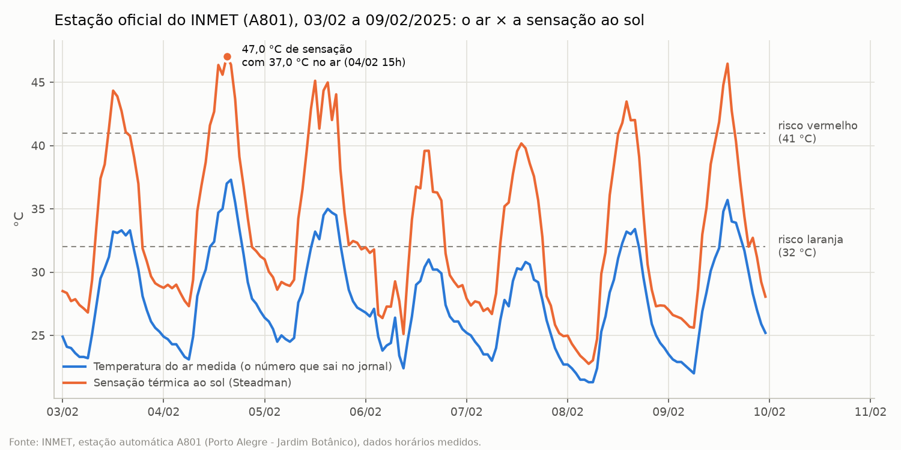

# Python — Cruzamento de dados reais e ranking dos locais mais quentes

> Ficha da CitizenTech: ver o [README principal](../README.md).

**Disciplina:** Computational Thinking with Python

## O problema
A previsão do tempo mostra **um número para a cidade inteira**. A estação oficial que mede esse número fica, como manda a norma, num gramado aberto e longe de prédios. Mas quem vai correr no Parque Harmonia ou atravessar o Largo Glênio Peres ao meio-dia está em cima de concreto, no sol, e sente outra coisa.

Este programa responde, **só com dados medidos**:
1. **Quanto o calor sentido passa da temperatura que sai no jornal?**
2. **Quais dos 4 locais do projeto são os mais quentes**, e por quê?

## O que o programa faz
Ele cruza três fontes de dados reais:

| Fonte | O que mede | Para que serve aqui |
|---|---|---|
| **INMET**, estação automática A801 (Jardim Botânico) | ar, umidade, vento e radiação do sol, hora a hora | a sensação térmica "oficial", com a mesma fórmula da estação Forno Alegre |
| **Landsat 8 e 9** (NASA/USGS) | a temperatura da **superfície** (piso, telhado, grama), em pixels de 30 m | comparar os 4 locais entre si |
| **Sentinel-2** (ESA) | o NDVI, o "índice de verde" | explicar **por que** um local é mais quente que outro |

```
INMET A801 (CSV oficial) ──► oficial.py ──► sensação hora a hora (ar × sol)
OpenStreetMap ─────────────► locais.py ───► a área de cada local
Landsat + Sentinel-2 ──────► satelite.py ─► superfície e NDVI de cada área
                                   │
                                   ▼
                              ranking.py ──► dados/ranking.csv + graficos/*.png
```

| Arquivo | O que faz |
|---|---|
| `sensacao.py` | A Temperatura Aparente de Steadman e os níveis de risco. É **a mesma conta do ESP32** (`edge/sensacao.h`), conferida pelos mesmos casos de teste |
| `oficial.py` | Lê o arquivo oficial do INMET (UTC → horário de Brasília, kJ/m² → W/m²) e calcula a sensação na sombra e ao sol |
| `locais.py` | Busca no OpenStreetMap a área de cada local: o polígono do largo e dos parques, e um círculo de 60 m em volta do calçadão |
| `satelite.py` | Acha as passagens de verão sem nuvens e pede ao Microsoft Planetary Computer a média, o mínimo e o máximo dos pixels dentro de cada área |
| `ranking.py` | Junta tudo, ordena os locais e gera os gráficos |
| `test_sensacao.py` e `test_dados.py` | 8 testes: a fórmula igual à do ESP32 e cada conversão conferida na mão |

## Quickstart (do zero, no Windows)
Precisa do Python 3.11 ou mais novo (testado no 3.14). No terminal, dentro da pasta `python/`:

```powershell
python -m venv .venv
.\.venv\Scripts\Activate.ps1
pip install -r requirements.txt
python ranking.py
```

Pronto: o ranking aparece no terminal, e os gráficos ficam em `graficos/`. Todos os dados medidos já estão em `dados/`, então **não precisa de internet nem de chave de API**.

Outras opções:
```powershell
python -m pytest                                        # roda os 8 testes
python oficial.py --inicio 2025-01-20 --fim 2025-01-26  # outra semana do INMET (dentro de 2025)
python satelite.py                                       # mostra as medidas de cada passagem
```

Para medir tudo de novo a partir das fontes, apague `dados/locais.geojson`, `dados/satelite_superficie.csv` e `dados/satelite_ndvi.csv` e rode `python ranking.py` (precisa de internet).

## Resultado 1 — O ar × a sensação (INMET, semana de 03 a 09/02/2025)
A semana inclui o dia 04/02/2025, quando o InGá mediu **61 °C no piso de concreto** do Parque Harmonia e cerca de **31 °C no gramado à sombra** ([Sul21, 05/02/2025](https://sul21.com.br/noticias/geral/2025/02/piso-de-concreto-do-parque-harmonia-chega-a-61-oc-formando-ilha-de-calor-no-centro-de-porto-alegre/)).

- A estação oficial **mediu no máximo 37,3 °C no ar**.
- Com o sol que ela mesma mediu, a **sensação ao sol chegou a 47,0 °C** (04/02, às 15h).
- Foram **80 horas** na semana com sensação ao sol de 32 °C ou mais (risco laranja ou vermelho).



## Resultado 2 — O ranking dos locais (satélite, 6 passagens de verão)
Passagens do Landsat sem nuvens (menos de 2% na cena) nos verões de 2024/25 e 2025/26: 26/12/2024, 04/02/2025, 08/03/2025, 06/01/2026, 14/01/2026 e 03/03/2026, sempre por volta das 10h20.

| Posição | Local | Superfície média no verão | Pixel mais quente | NDVI | Acima do ar do INMET* |
|---|---|---|---|---|---|
| 1 | Parque Harmonia | 41,5 °C | 50,4 °C | 0,38 | +13,7 °C |
| 2 | Largo Glênio Peres | 39,5 °C | 46,8 °C | 0,16 | +11,6 °C |
| 3 | Parque Marinha do Brasil | 37,7 °C | 46,9 °C | 0,57 | +10,1 °C |
| 4 | Calçadão da Rua dos Andradas | 35,7 °C | 41,9 °C | 0,44 | +7,8 °C |

\* média das 2 passagens de 2025 (04/02 e 08/03), comparando com o ar medido pelo INMET na mesma hora. As outras passagens estão fora do arquivo do INMET de 2025.


**Como ler:**
- **A ordem quase não muda:** o Harmonia foi o mais quente em 5 das 6 passagens (em 26/12/2024, o Largo passou 0,2 °C à frente), e o calçadão foi o mais fresco em todas. Não é sorte de um dia.
- **O Harmonia lidera** porque tem grandes áreas abertas e pavimentadas, com o sol batendo direto. No dia da medição do InGá (04/02/2025), às 10h18, o pixel mais quente do parque já marcava 50,4 °C; às 13h30, com mais 3 horas de sol, o InGá mediu 61 °C no piso.
- **O Largo Glênio Peres** tem o menor NDVI (0,16, quase sem verde) e fica em 2º lugar.
- **O Marinha do Brasil é um parque, mas não é inteiro sombra:** a média inclui gramados abertos, quadras e estacionamentos ao sol. A parte sob as árvores aparece no mínimo da área, que é o ponto mais fresco de todos os 4 locais (32,1 °C em média).
- **O calçadão saiu o mais fresco, e isso tem duas explicações reais:** às 10h20, os prédios fazem sombra no calçadão, e o círculo medido fica a 80 m da Praça da Alfândega, que é arborizada (por isso o NDVI de 0,44).

## O que os dados reais mostram (e o que não mostram)
- **Superfície não é ar:** o satélite mede a temperatura do piso, e não a do ar nem a sensação térmica. Um piso a 46 °C esquenta quem está em cima, mas a sensação depende também do ar, da umidade e do vento.
- **Ninguém mede o ar no Largo Glênio Peres.** A sensação térmica hora a hora em cada local **não existe como dado público**: a estação oficial mais próxima fica no Jardim Botânico. **Essa é a lacuna que as estações do Forno Alegre vêm preencher.** Por isso, este programa não inventa a sensação em cada local: ele mostra o que dá para medir hoje.
- **O satélite passa às 10h20.** O pico do calor é entre 13h e 16h, então as diferenças à tarde tendem a ser maiores. É uma limitação do horário do satélite.
- **Resolução:** o sensor térmico do Landsat mede em blocos de 100 m (entregues em pixels de 30 m). Ele não consegue isolar uma rua de pedestres de 15 m entre prédios: no calçadão, ele mede o quarteirão, telhados incluídos.
- **Uma só estação oficial:** a A801 representa a cidade. A estação B825 (Belém Novo) só começou em maio de 2025 e fica longe do Centro.

## Fontes dos dados
- **INMET**, Banco de Dados Meteorológicos, dados históricos de 2025, estação automática A801 (Porto Alegre - Jardim Botânico): [portal.inmet.gov.br/dadoshistoricos](https://portal.inmet.gov.br/dadoshistoricos). O arquivo da estação está em `dados/inmet_A801_2025.csv`, sem mudanças.
- **Landsat 8 e 9**, Coleção 2, Nível 2, temperatura da superfície (NASA/USGS), e **Sentinel-2** Nível 2A (ESA/Copernicus), via [Microsoft Planetary Computer](https://planetarycomputer.microsoft.com/).
- **OpenStreetMap** (© colaboradores do OpenStreetMap, licença ODbL), pelo serviço Nominatim: as áreas dos 4 locais.
- **Fórmula de Steadman** (Temperatura Aparente com vento e radiação, 1994), a mesma usada pelo serviço de meteorologia da Austrália. **Limites de risco** (27, 32 e 41 °C): categorias do índice de calor da NOAA.
- **Medição do Parque Harmonia:** InGá, divulgada pelo Sul21 em 05/02/2025 (temperatura de superfície, medição pontual de uma ONG).

Nenhum dado pessoal é usado.
