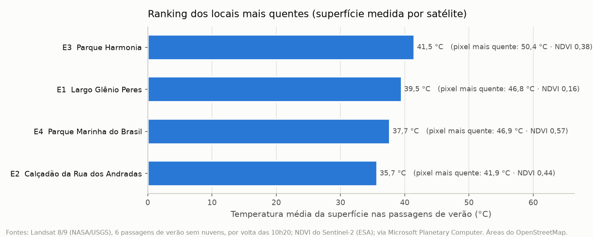

# Python — Cruzamento de dados reais e ranking dos locais mais quentes

## Ficha da CitizenTech
- **Nome:** Clima Real POA
- **Cidade e bairro:** Porto Alegre — região central (Centro Histórico e Praia de Belas)
- **Cidadão beneficiado:** quem vai a locais ao ar livre para lazer, com atenção aos grupos de risco (idosos, crianças, gestantes e pessoas com doença crônica); a estação também protege quem não usa o app, e a prefeitura usa os dados para decidir onde sombrear
- **Problema em uma frase:** Porto Alegre já mede o tempo em 16 pontos, mas nenhum diz quanto calor a pessoa sente na praça, nem avisa, nem refresca.
- **Como funciona:** estações com ESP32 em locais de lazer medem temperatura, umidade, vento e sol, calculam a sensação térmica real, avisam o risco e ligam a refrigeração do local; o app recomenda o local e o horário mais seguros para cada atividade, e os dados formam um mapa do calor real da cidade.
- **O que cada parte faz:** Sensor (mede e alerta) · Lógica (ranking dos locais críticos) · Matemática (taxa de aquecimento e dose de calor) · Interface (mapa acessível) · Interação (cadastro de locais de lazer e pontos de hidratação) · Experiência (requisitos e backlog) · Pitch (história)
- **Link do repositório:** https://github.com/mVmarquesVm/clima_real_poa
- **Indicador de impacto:** horas/dia em nível de risco por local; diferença entre o calor oficial e o medido
- **ODS conectados:** 3, 10, 11 e 13

**Disciplina:** Computational Thinking with Python

## O problema
A previsão do tempo mostra **um número para a cidade inteira**. A estação oficial que mede esse número fica, como manda a norma, num gramado aberto e longe de prédios. Mas quem vai correr no Parque Harmonia ou atravessar o Largo Glênio Peres ao meio-dia está em cima de concreto, no sol, e sente outra coisa.

Este programa responde, **só com dados medidos**:
1. **Quanto o calor sentido passa da temperatura que sai no jornal?**
2. **Quais dos 4 locais do projeto são os mais quentes**, e por quê?

## O que o programa faz
Ele cruza três fontes de dados reais:

| Fonte | O que mede | Para que serve aqui |
|---|---|---|
| **INMET**, estação automática A801 (Jardim Botânico) | ar, umidade, vento e radiação do sol, hora a hora | a sensação térmica "oficial", com a mesma fórmula da estação Clima Real POA |
| **Landsat 8 e 9** (NASA/USGS) | a temperatura da **superfície** (piso, telhado, grama), em pixels de 30 m | comparar os 4 locais entre si |
| **Sentinel-2** (ESA) | o NDVI, o "índice de verde" | explicar **por que** um local é mais quente que outro |

```
INMET A801 (CSV oficial) ──► oficial.py ──► sensação hora a hora (ar × sol)
OpenStreetMap ─────────────► locais.py ───► a área de cada local
ESA WorldCover ────────────► cobertura.py ► a área que cada ESTAÇÃO representa
Landsat + Sentinel-2 ──────► satelite.py ─► superfície e NDVI dessa área
                                   │
                                   ▼
                              ranking.py ──► dados/ranking.csv + graficos/*.png
```

```
python/
├── fontes/          buscam e leem os dados de cada fonte
│   ├── oficial.py
│   ├── locais.py
│   ├── cobertura.py
│   └── satelite.py
├── processamento/   calculam e geram as saídas
│   ├── sensacao.py
│   ├── ranking.py
│   └── exportar_front.py
├── testes/          conferem as contas
├── dados/           os dados já medidos (CSV e GeoJSON)
└── graficos/        os PNGs gerados
```

| Arquivo | O que faz |
|---|---|
| `processamento/sensacao.py` | A Temperatura Aparente de Steadman e os níveis de risco. É **a mesma conta do ESP32** (`edge/sensacao.h`), conferida pelos mesmos casos de teste |
| `fontes/oficial.py` | Lê o arquivo oficial do INMET (UTC → horário de Brasília, kJ/m² → W/m²) e calcula a sensação na sombra e ao sol |
| `fontes/locais.py` | Busca no OpenStreetMap a área de cada local: o polígono do largo e dos parques, e um círculo de 60 m em volta do calçadão |
| `fontes/cobertura.py` | Mede a cobertura do solo (ESA WorldCover) e decide a área que cada estação representa: o local inteiro, se ele é quase todo construído, ou um raio de 50 m, se é misto |
| `fontes/satelite.py` | Acha as passagens de verão sem nuvens e pede ao Microsoft Planetary Computer a média, o mínimo e o máximo dos pixels dentro de cada área |
| `processamento/ranking.py` | Junta tudo, ordena os locais e gera os gráficos |
| `processamento/exportar_front.py` | Copia o ranking do satélite para o Front-end (`frontend/src/dados/locais.json`) |
| `testes/test_sensacao.py` e `testes/test_dados.py` | 10 testes: a fórmula igual à do ESP32, cada conversão conferida na mão e a regra da cobertura |

As pastas `fontes/` e `processamento/` são **pacotes** do Python (têm um `__init__.py`). Por isso os scripts rodam com `python -m pasta.arquivo`, sempre de dentro de `python/`.

## Quickstart (do zero, no Windows)
Precisa do Python 3.11 ou mais novo (testado no 3.14). No terminal, dentro da pasta `python/`:

```powershell
python -m venv .venv
.\.venv\Scripts\Activate.ps1
pip install -r requirements.txt
python -m processamento.ranking
```

Pronto: o ranking aparece no terminal, e os gráficos ficam em `graficos/`. Todos os dados medidos já estão em `dados/`, então **não precisa de internet nem de chave de API**.

Outras opções:
```powershell
python -m pytest                                                # roda os 10 testes
python -m fontes.oficial --inicio 2025-01-20 --fim 2025-01-26   # outra semana do INMET (dentro de 2025)
python -m fontes.satelite                                       # mostra as medidas de cada passagem
python -m fontes.cobertura                                      # mostra o solo de cada local e de cada estação
python -m processamento.exportar_front                          # atualiza o JSON do Front-end
```

Para medir tudo de novo a partir das fontes (precisa de internet): apague `dados/locais.geojson`, `dados/estacoes.geojson` e `dados/cobertura_solo.csv`, rode `python -m fontes.satelite --refazer` e depois `python -m processamento.ranking`.

## Resultado 1 — O ar × a sensação (INMET, semana de 03 a 09/02/2025)
A semana inclui o dia 04/02/2025, quando o InGá mediu **61 °C no piso de concreto** do Parque Harmonia e cerca de **31 °C no gramado à sombra** ([Sul21, 05/02/2025](https://sul21.com.br/noticias/geral/2025/02/piso-de-concreto-do-parque-harmonia-chega-a-61-oc-formando-ilha-de-calor-no-centro-de-porto-alegre/)).

- A estação oficial **mediu no máximo 37,3 °C no ar**.
- Com o sol que ela mesma mediu, a **sensação ao sol chegou a 47,0 °C** (04/02, às 15h).
- Foram **71 horas** na semana com sensação ao sol de 34 °C ou mais (risco laranja ou acima), e **32 horas** com 40 °C ou mais (vermelho). Nenhuma hora chegou ao roxo (52 °C).


## Resultado 2 — O ranking dos locais (satélite, 6 passagens de verão)

**Qual área o satélite mede:** a que a **estação** representa, e não o parque inteiro. Um sensor de ar a ~1,5 m de altura "enxerga" só algumas dezenas de metros em volta (Guia de Instrumentos da Organização Meteorológica Mundial, WMO-No. 8, 2008, Parte II, cap. 11, seção 11.1.1.4). Então:
- **Local homogêneo** (80% ou mais construído): o calor é parecido em toda a área, e a estação vale para o local inteiro.
- **Local misto** (concreto + árvore/grama): a estação vale só para um **raio de 50 m** em volta dela.

O limite de 80% é uma escolha nossa. Ele não muda o resultado: o Largo tem 91%, e os outros ficam entre 14% e 51%.

| Local | Construído no local inteiro (WorldCover 2021) | Regra | Ponto da estação |
|---|---|---|---|
| Largo Glênio Peres | 91% | local inteiro | centro do Largo (OSM) |
| Calçadão da Rua dos Andradas | 51% (o resto é árvore) | raio de 50 m | centro do trecho de pedestres (OSM) |
| Parque Harmonia | 15% (52% grama, 31% árvore) | raio de 50 m | na maior área pavimentada do parque (OSM way 1315610353, ~7.400 m²); 62% construído no raio |
| Parque Marinha do Brasil | 14% (42% árvore, 32% grama) | raio de 50 m | sob as árvores, num ponto com 100% de árvore no raio: é o controle |

Fonte da cobertura do solo: **ESA WorldCover 10 m 2021** (v200), pelo Microsoft Planetary Computer.

Passagens do Landsat sem nuvens (menos de 2% na cena) nos verões de 2024/25 e 2025/26: 26/12/2024, 04/02/2025, 08/03/2025, 06/01/2026, 14/01/2026 e 03/03/2026, sempre por volta das 10h20.

| Posição | Local | Superfície média no verão | Pixel mais quente | NDVI | Acima do ar do INMET* |
|---|---|---|---|---|---|
| 1 | Parque Harmonia (piso, raio de 50 m) | 41,7 °C | 48,1 °C | 0,16 | +13,6 °C |
| 2 | Largo Glênio Peres (local inteiro) | 39,5 °C | 46,8 °C | 0,16 | +11,6 °C |
| 3 | Parque Marinha do Brasil (sob as árvores, raio de 50 m) | 35,9 °C | 41,1 °C | 0,83 | +8,4 °C |
| 4 | Calçadão da Rua dos Andradas (raio de 50 m) | 35,6 °C | 41,9 °C | 0,43 | +7,7 °C |

\* média das 2 passagens de 2025 (04/02 e 08/03), comparando com o ar medido pelo INMET na mesma hora. As outras passagens estão fora do arquivo do INMET de 2025.



**Como ler:**
- **O topo é firme:** o piso do Harmonia foi mais quente que o Largo nas **6 de 6** passagens, e os dois ficaram sempre acima dos outros. Não é sorte de um dia.
- **O Harmonia lidera** porque a estação fica na maior área pavimentada do parque, com o sol batendo direto. No dia da medição do InGá (04/02/2025), às 10h18, o pixel mais quente desse piso já marcava 48,1 °C; às 13h30, com mais 3 horas de sol, o InGá mediu 61 °C no piso (o Sul21 não diz em que ponto do parque).
- **O Largo Glênio Peres** tem o NDVI mais baixo, junto com o piso do Harmonia (0,16, quase sem verde), e fica em 2º lugar.
- **O 3º e o 4º lugares estão empatados:** sob as árvores do Marinha (NDVI 0,83), a superfície ficou só 0,3 °C acima do calçadão na média. O Marinha foi o mais fresco em 4 das 6 passagens; nas 2 de março, ficou acima. Antes, medindo o parque inteiro (com gramados e quadras ao sol), o Marinha dava 37,7 °C: 1,8 °C a mais. É por isso que a área da estação importa.
- **O calçadão também sai fresco, por dois motivos reais:** às 10h20, os prédios fazem sombra nele, e metade do raio de 50 m é árvore (a Praça da Alfândega e as árvores da rua), por isso o NDVI de 0,43.

## O que os dados reais mostram (e o que não mostram)
- **Superfície não é ar:** o satélite mede a temperatura do piso, e não a do ar nem a sensação térmica. Um piso a 46 °C esquenta quem está em cima, mas a sensação depende também do ar, da umidade e do vento.
- **Ninguém mede o ar no Largo Glênio Peres.** A sensação térmica hora a hora em cada local **não existe como dado público**: a estação oficial mais próxima fica no Jardim Botânico. **Essa é a lacuna que as estações do Clima Real POA vêm preencher.** Por isso, este programa não inventa a sensação em cada local: ele mostra o que dá para medir hoje.
- **O satélite passa às 10h20.** O pico do calor é entre 13h e 16h, então as diferenças à tarde tendem a ser maiores. É uma limitação do horário do satélite.
- **Resolução:** o sensor térmico do Landsat mede em blocos de 100 m (entregues em pixels de 30 m). Ele não consegue isolar uma rua de pedestres de 15 m entre prédios: no calçadão, ele mede o quarteirão, telhados incluídos. Num raio de 50 m (100 m de diâmetro), ele "vê" mais ou menos um bloco: os vizinhos entram um pouco na conta, e por isso a diferença entre o Marinha e o calçadão (0,3 °C) é pequena demais para tirar conclusão.
- **Cobertura do solo de 2021:** o WorldCover é de 2021. Se um local mudou depois (obra, corte de árvores), a regra pode mudar.
- **Uma só estação oficial:** a A801 representa a cidade. A estação B825 (Belém Novo) só começou em maio de 2025 e fica longe do Centro.

## Fontes dos dados
- **INMET**, Banco de Dados Meteorológicos, dados históricos de 2025, estação automática A801 (Porto Alegre - Jardim Botânico): [portal.inmet.gov.br/dadoshistoricos](https://portal.inmet.gov.br/dadoshistoricos). O arquivo da estação está em `dados/inmet_A801_2025.csv`, sem mudanças.
- **Landsat 8 e 9**, Coleção 2, Nível 2, temperatura da superfície (NASA/USGS), e **Sentinel-2** Nível 2A (ESA/Copernicus), via [Microsoft Planetary Computer](https://planetarycomputer.microsoft.com/).
- **OpenStreetMap** (© colaboradores do OpenStreetMap, licença ODbL), pelo serviço Nominatim: as áreas dos 4 locais.
- **ESA WorldCover 10 m 2021** (v200, © ESA WorldCover project 2021, licença CC BY 4.0), via Microsoft Planetary Computer: a cobertura do solo de cada local.
- **Guia de Instrumentos e Métodos de Observação da OMM** (WMO-No. 8, 7ª ed., 2008), Parte II, cap. 11, seção 11.1.1.4: o alcance de um sensor de ar em área urbana.
- **Fórmula de Steadman** (Temperatura Aparente com vento e radiação, 1994), a mesma usada pelo serviço de meteorologia da Austrália. **Limites de risco** (27, 34, 40 e 52 °C): as 5 faixas da [Nota Técnica nº 01/26 da Secretaria Municipal de Saúde de Porto Alegre](https://prefeitura.poa.br/sites/default/files/usu_doc/hotsites/sms/vigilancia-em-saude/NT%201_26_Calor%20extremo.pdf) (atualizada em 04/02/2026), uma adaptação das categorias do índice de calor da NOAA. A nota mede na sombra; aqui a sensação inclui o sol, então a régua fica mais rigorosa quando bate sol.
- **Medição do Parque Harmonia:** InGá, divulgada pelo Sul21 em 05/02/2025 (temperatura de superfície, medição pontual de uma ONG).

Nenhum dado pessoal é usado.
